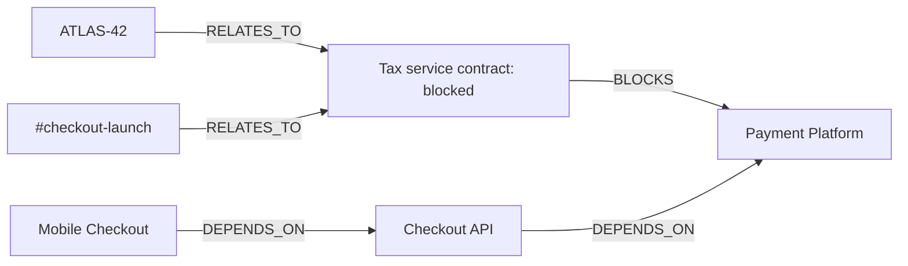

# ContextPilot — Graph Hacks three-track submission

> A local, evidence-backed company-context agent built with **FalkorDB** and **Streamlit**.

ContextPilot models a fictional retailer, **Northstar Commerce**, as a connected graph. It helps a team answer questions that ordinary tables struggle with: ownership, dependency risk, affected customers, supporting documents, and decisions that must persist for later work.

## Judge verification — all three tracks

| Track | What to do in the app | Proof stored in FalkorDB |
| --- | --- | --- |
| **01 — Agents That Act on Connected Data** | Use **Track 1: triage an incident** in the sidebar, then ask `Show open handoffs`. | `WorkItem`, `AgentHandoff`, the incident, and the assigned person are connected by graph edges. |
| **02 — Agent Memory and Coordination** | Ask any question, refresh the browser, then ask `Show recent memory`. Create a triage handoff and ask `Show open handoffs`. | Each question becomes an `Episode`; decisions, work items, and handoffs remain in the graph under `tenant-northstar`. |
| **03 — Company Brain** | Ask `What is blocking the mobile checkout launch?` and expand evidence. | People, teams, projects, systems, docs, tickets, chats, customers, and incidents provide a sourced multi-hop answer. |

All three flows run locally. No API key, cloud account, or paid model is required.

## The scenario

Northstar Commerce is preparing several interdependent initiatives:

- **Mobile Checkout** is a one-page payment launch. It depends on Checkout API, which depends on Payment Platform.
- **Atlas** is a checkout modernization effort. Its blocked tax-service contract blocks Payment Platform validation, which in turn blocks the Mobile Checkout launch.
- **TrustShield** improves fraud review. Its unresolved fraud-rule work blocks the Fraud Engine.
- **LedgerSync** reconciles payment events with Finance Ledger.
- **Partner Portal** gives retail partners order and support visibility.

The app uses only deterministic synthetic data. No customer, company, or cloud data is sent anywhere.

## Why a graph?

The answer to “What is blocking Mobile Checkout?” is not stored in one record. ContextPilot traverses connected evidence:



This produces an answer, the evidence backing it, and the graph path used.

## Graph model

| Node type | Examples | Purpose |
| --- | --- | --- |
| `Person`, `Team` | Sarah Chen, Platform | Ownership and expertise |
| `Project`, `Task`, `System` | Mobile Checkout, Tax Service | Work and dependency context |
| `Document`, `Ticket`, `ChatMessage` | Launch brief, ATLAS-42, channel update | Traceable supporting evidence |
| `Incident`, `Customer` | Tax timeout, Northwind Retail | Operational and customer impact |
| `Decision`, `Episode`, `Procedure` | Approved decisions, question/answer memory, triage runbook | Semantic, episodic, and procedural memory |
| `Agent`, `AgentHandoff`, `WorkItem`, `Tenant` | Risk analyst, delivery coordinator, assigned triage work | Shared coordination state and tenant boundary |

Important relationships include `OWNS`, `LEADS`, `WORKS_ON`, `DEPENDS_ON`, `BLOCKS`, `RELATES_TO`, `USES`, `AFFECTED_BY`, `MADE`, and `ABOUT`.

## Quick start (Windows)

Prerequisites: Docker Desktop, Python, and a running FalkorDB container from `compose.yaml`.

```powershell
cd C:\Users\compa\contextpilot
.\.venv\Scripts\Activate.ps1
docker compose up -d
python generate_company_data.py
python seed_graph.py
python validate_graph.py
streamlit run app.py
```

Open the URL shown by Streamlit, normally `http://localhost:8501`.

## Submission checklist

1. Create a GitHub repository and push this folder (instructions below).
2. On the [Graph Hacks event page](https://www.wemakedevs.org/hackathons/falkordb), sign in, select the registered team, and use its submission panel before the deadline.
3. Provide the repository URL, a short project description, and a demo video URL if the panel asks for them. The event page says a live deployment is preferred; a project without one needs complete local instructions and a working demo video.
4. Enter ContextPilot for **Track 01, Track 02, and Track 03** if the form allows multi-track selection.

### Push to GitHub

Create an empty repository on GitHub named `contextpilot`, then run these commands in PowerShell. Replace `YOUR-USERNAME` with your GitHub username.

```powershell
cd C:\Users\compa\contextpilot
git init
git add .
git commit -m "Build ContextPilot Graph Hacks submission"
git branch -M main
git remote add origin https://github.com/YOUR-USERNAME/contextpilot.git
git push -u origin main
```

After the push, your repository URL is:

```text
https://github.com/YOUR-USERNAME/contextpilot
```

Paste that URL into the event submission panel if it asks for a repository. Do not commit `.venv/`, Docker volumes, or Streamlit secrets; `.gitignore` already excludes the first two sensitive/local categories.

## Viewing the FalkorDB graph

Open **http://localhost:3000** while Docker Desktop and `docker compose up -d` are running. In FalkorDB Browser, select the `contextpilot` graph and run:

```cypher
MATCH path = (project:Project {id: 'project-mobile-checkout'})-[:DEPENDS_ON*1..2]->(system:System)<-[:BLOCKS]-(task:Task)
RETURN path
```

This visualizes the Track 3 Mobile Checkout risk path. For Track 1 and Track 2 after you use the app actions, run:

```cypher
MATCH path = (:Agent)-[:HANDOFF_TO]->(:AgentHandoff)-[:CREATED]->(:WorkItem)-[:ASSIGNED_TO]->(:Person)
RETURN path
```

## Optional scale benchmark

Run this only when you want to demonstrate local scale testing:

```powershell
python benchmark_scale.py
```

It uses a separate `contextpilot_benchmark` graph and creates 1,000 payment events plus connected risk alerts. It never changes the `contextpilot` demonstration graph, so it is safe to run before or after a judge demo.

## Demo questions

- `Who owns the payment platform?`
- `What is blocking the mobile checkout launch?`
- `What is the fraud risk?`
- `Which customers are affected by incidents?`
- `Show tasks for the Atlas program`
- `What decisions have been made for Mobile Checkout?`
- `Show recent memory`
- `Show open handoffs`

Use **Record a decision** in the sidebar to persist a decision. Refresh or open a new browser session, then ask for decisions again: the answer comes from FalkorDB, not Streamlit session state.

## Track implementation

| Track | Current status | Evidence in ContextPilot |
| --- | --- | --- |
| **Track 1 — Agents that act on connected data** | Complete local demo | The risk agent follows the incident/dependency graph and the triage action creates an assigned `WorkItem`; a persisted `AgentHandoff` records the action. |
| **Track 2 — Agent memory and coordination** | Complete local demo | `Episode` nodes retain conversations, `Decision` nodes retain semantic knowledge, `Procedure` nodes represent the runbook, and two graph agents share handoff state inside `tenant-northstar`. |
| **Track 3 — Company Brain** | Complete local demo | The company graph unifies operational work, sources, customers, and incidents. Answers display sources and traversed paths; human decisions are written back to the graph. |

## Reliability and performance choices

- **Safe query templates:** user questions select known read-only Cypher templates; user-provided decision text is passed as query parameters.
- **Connection recovery:** read queries retry once and report a friendly Docker/FalkorDB error if unavailable.
- **Connection reuse:** the local graph client is cached in-process.
- **Bounded UI cache:** dashboard metrics use a 15-second, one-entry cache and are cleared after a decision write.
- **Idempotent seed:** `MERGE` makes re-seeding safe; it updates rather than duplicates the synthetic data.
- **Validation script:** `validate_graph.py` checks source evidence, the launch-risk path, and source-backed ownership.

## Repository layout

```text
contextpilot/
├── app.py                    # Streamlit chat UI and decision action
├── agent.py                  # Explainable, fixed-query local agent
├── graph_db.py               # Resilient FalkorDB access helpers
├── generate_company_data.py  # Deterministic Northstar Commerce fixture generator
├── company_data.json         # Generated synthetic fixture
├── seed_graph.py             # Idempotent graph seeding
├── validate_graph.py         # Integration checks
├── compose.yaml              # Local FalkorDB service
└── test_db.py                # Original connection smoke test
```

## Limits and next steps

This is a complete local demonstration of each track. Production upgrades could include:

1. Add a Track 1 incident triage action that assigns work after impact analysis.
2. Add Track 2 memory per user/tenant and a second agent that consumes shared decisions.
3. Ingest real exported documents/tickets only after removing sensitive content and adding access controls.

## License

Demo project for the Graph Hacks challenge. Replace this section with your chosen license before publishing.
